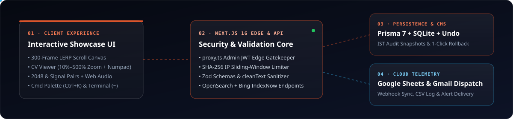
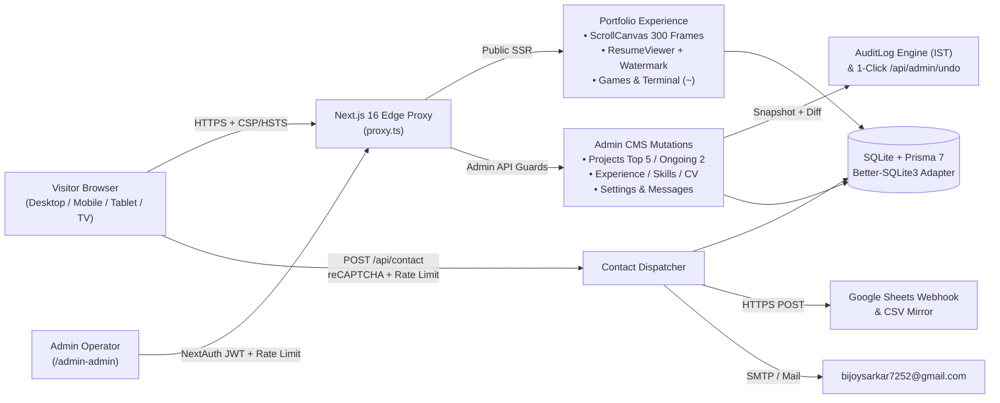

<div align="center">

<!-- Animated Cyber Portfolio Hero Banner -->


<br />
<br />

<!-- Tech Stack & Live Status Badges -->
[](https://nextjs.org/)
[](https://react.dev/)
[](https://www.typescriptlang.org/)
[](https://tailwindcss.com/)
[](https://www.prisma.io/)
[](https://www.sqlite.org/)
[](https://www.docker.com/)

[](https://bijoy-sarkar-portfolio.vercel.app)
[](https://bijoy-sarkar-portfolio.vercel.app/admin-admin)
[](https://bijoy-sarkar-portfolio.vercel.app/opensearch.xml)

<p>
  <strong>Full-Stack Engineering · Artificial Intelligence &amp; Computer Vision · Cybersecurity · Interactive Web Architecture</strong>
</p>

<p>
  <a href="#-live-deployments--discovery-endpoints">Live Endpoints</a> •
  <a href="#-system-architecture">Architecture</a> •
  <a href="#-core-engineering-pillars">Features</a> •
  <a href="#-security-hardening--defense-in-depth">Security</a> •
  <a href="#-api--route-reference">API Reference</a> •
  <a href="#-getting-started">Getting Started</a> •
  <a href="#-docker-deployment">Docker</a>
</p>

</div>

---

## 👋 Overview

**Bijoy Sarkar Portfolio OS** is a production-grade, database-driven personal engineering showcase built with **Next.js 16 (App Router + Turbopack)**, **React 19**, **TypeScript**, and **Prisma 7 (SQLite adapter)**. Built for **Bijoy Sarkar** (Software Engineer & AI Developer, B.Tech Computer Science & Engineering at ICFAI University Tripura), the platform blends high-frame-rate visual storytelling with enterprise-ready security, telemetry, and content management.

From a hardware-accelerated **300-frame scroll canvas** with dynamic subject focal centering to an **isolated Admin CMS** featuring **Indian Standard Time (`IST`) audit trails**, **one-click undo rollback**, **Google Sheets webhook synchronization**, and **browser-native OpenSearch telemetry**, every layer is engineered cleanly from UI down to edge middleware.

---

## 🌐 Live Deployments & Discovery Endpoints

| Purpose | Description | Live Endpoint |
| :--- | :--- | :--- |
| **Public Portfolio Showcase** | Interactive 300-frame canvas experience, intelligent systems & ongoing builds, adaptive CV viewer, retro arcade, and contact inquiry dispatch. | 🚀 [**bijoy-sarkar-portfolio.vercel.app**](https://bijoy-sarkar-portfolio.vercel.app) |
| **Admin Management Portal** | Isolated JWT-protected CMS for curating Top 5 Main & Top 2 Ongoing projects, experiences, skills, CV uploads, site copy, messages inbox, and IST undo audit logs. | 🛡️ [**bijoy-sarkar-portfolio.vercel.app/admin-admin**](https://bijoy-sarkar-portfolio.vercel.app/admin-admin) |
| **Projects Archive Index** | Dedicated filterable index of all published systems, architectures, and case studies. | 🧩 [**bijoy-sarkar-portfolio.vercel.app/projects**](https://bijoy-sarkar-portfolio.vercel.app/projects) |
| **OpenSearch Auto-Discovery** | Browser address bar search integration & real-time omnibox suggestions API for Chrome, Edge, Firefox, and Opera. | 🔍 [**opensearch.xml**](https://bijoy-sarkar-portfolio.vercel.app/opensearch.xml) |
| **Dynamic Search Suggestions** | OpenSearch `application/x-suggestions+json` endpoint returning structured portfolio, CV, and project results. | ⚡ [**`/api/search-suggest?q=bijoy`**](https://bijoy-sarkar-portfolio.vercel.app/api/search-suggest?q=bijoy) |
| **Dynamic Sitemap & Robots** | Real-time Prisma-backed XML sitemap and crawler rules tailored for Googlebot, Googlebot-Image, Bingbot, and DuckDuckBot. | 🗺️ [**sitemap.xml**](https://bijoy-sarkar-portfolio.vercel.app/sitemap.xml) · [**robots.txt**](https://bijoy-sarkar-portfolio.vercel.app/robots.txt) |

---

## 🏗️ System Architecture

<div align="center">
  
</div>

<br />



---

## 🌟 Core Engineering Pillars

### 1. 🎞️ Smooth 300-Frame Scroll Canvas & Adaptive Framing
- **300 Sequence Frames**: Hardware-accelerated `<canvas>` scrubbing cleanly across `frame_0001.jpg` to `frame_0300.jpg` in `/public/frames/`.
- **Zero Edge Gaps & Cover Math**: Draws every frame with `1.20x` cover scaling and 4-way clamped boundaries to eliminate letterboxing or dark borders on ultrawide (`21:9`, `32:9`), desktop, tablet, and mobile viewports.
- **Smart Mobile & Portrait Focal Alignment**: When aspect ratio `width / height < 1.3`, the canvas anchors horizontally and vertically around Bijoy's head (`X ≈ 0.422`, `Y ≈ 0.23`) so facial framing stays centered across narrow displays.
- **Low-Power Optimization**: Time-based LERP smoothing, predictive frame preloading queue, and adaptive memory management keep animations responsive even on modest hardware.
- **Admin Route Isolation**: Canvas and ambient overlays are completely omitted on `/admin-admin/*` routes.

---

### 2. 📄 Interactive CV Document Viewer & Anti-Leak Protection
- **High-Fidelity Page Rendering**: Cleanly renders CV document pages fitting the container across phones, iPads, desktops, and 4K displays without native browser PDF plugin scrollbars.
- **Uniform 4-Sided Bezel & Custom Scrollbar**: Features symmetric `6px` bezels paired with a hardware pointer-tracked glowing orange scrollbar inside the viewport.
- **Numeric Zoom Engine (`10% – 500%`)**:
  - Editable single zoom box with automatic `%` suffix and `10%` step `+` / `-` buttons.
  - Accepts numeric digits only and triggers native number keypads on iOS/Android (`inputMode="numeric"`, `pattern="[0-9]*"`).
- **Adaptive Jump-to-Page Selector (`1 / N`)**: Automatically adjusts total page count `N` whenever an updated CV is uploaded via Admin CMS or disk; users can type any page number directly with mobile numpad support.
- **Mobile-Readable Header**: Dynamically expands into a tidy 2-tier layout on viewports `≤ 640px` so the full CV filename (`Bijoy_Sarkar_CV.pdf`) remains 100% readable without ellipsis truncation.
- **Subtle Anti-Leak Watermark**: Non-intrusive diagonal `bijoy-sarkar-portfolio` overlay calibrated to keep reading effortless while remaining clearly visible in screenshots or screen recordings.

---

### 3. 🖱️ Custom Scrollbars, Edge Overscroll & Dynamic Navigation
- **Zero Native Browser Scrollbars**: Native scrollbars are hidden cleanly across Chrome, Safari, Firefox, and Edge, replaced by [`CustomScrollbar.tsx`](components/ui/CustomScrollbar.tsx) — a floating orange progress indicator that fades smoothly after `1s` of scroll inactivity.
- **Boundary Spring Transitions**: Top and bottom aura overlays + spring `translateY` overscroll indicators in [`ScrollEdgeEffects.tsx`](components/ui/ScrollEdgeEffects.tsx).
- **Cyber Glassmorphic Mobile Drawer**: Dark blurred overlay drawer with staggered cascading item reveals (`01`..`06`) and click-through prevention.
- **All-Year Dynamic Copyright**: [`DynamicCopyright.tsx`](components/ui/DynamicCopyright.tsx) keeps `© {year} Bijoy Sarkar. All rights reserved.` synchronized dynamically with the visitor's current calendar year forever without changing font or layout sizing.

---

### 4. 📦 Curated Projects Architecture & Fallback Engine
- **Active Development / Ongoing Builds**: Dedicated spotlight subsection for in-progress builds (e.g., *CivicLens Core*) with one-click Admin promotion to finished projects.
- **Strict Home Showcase Limits**:
  - **Main Showcase Cap (`Top 5`)**: Enforces at most 5 featured completed projects (`featuredOnHome === true && !isOngoing`).
  - **Ongoing Showcase Cap (`Top 2`)**: Enforces at most 2 featured ongoing projects (`featuredOnHome === true && isOngoing`).
- **Browse Index & Case Studies**: Dedicated `/projects` catalog and dynamic `/projects/[slug]` project detail pages with galleries and live links.
- **Graceful Fallbacks**: Empty sections (Work Experience, Skills & Languages, Projects, or Resume) display `"Upcoming on his way"`.

---

### 5. 📱 Contact Validation, Smart Email Routing & Google Sheets Sync
- **Mandatory Dial-Code Matrix**: Visitors select an international country code (India first + searchable alphabetical list), `None`, or `Custom`.
- **Smart Phone Validation**: Eliminates ambiguity (no `(optional)` phone hint when a country code is chosen); India (`+91`) strictly requires 10 digits with device-native numeric keypads.
- **Device-Aware Email Routing**: Opens Gmail Web Compose prefilled for `bijoysarkar7252@gmail.com` on desktop or invokes native mobile handlers cleanly, while always copying the email address to clipboard with feedback toast.
- **Dual Persistence & Live Sheet Dispatch**: Saves every submission to `ContactMessage` (timestamped in `IST`), appends to `/public/downloads/contact-submissions.csv`, and dispatches directly to the Google Apps Script webhook synced to Google Drive.

---

### 6. 🎮 Retro Intermission Arcade & Cyber Developer UX
- **Built-in Intermission Games (`2048` & `Signal Pairs`)**:
  - `(i)` hover guide containing Objective, Rules, Controls, Winning Conditions, and Pro Diagrams **strictly contained within `.game-card` borders**.
  - Match timers trigger on first input; idle coach prompts activate after **10 seconds** of inactivity.
- **Tactile Web Audio Synthesizer** ([`lib/audio.ts`](lib/audio.ts)): Pure Web Audio API synthesis (clicks, merge chimes, flips, fanfare) with persistent sound mute control and waveform indicator.
- **Command Palette (`Ctrl+K` / `⌘K`) & Zsh Hacker Terminal (`~`)**: Keyboard shortcuts for rapid navigation and shell-style commands (`about`, `skills`, `projects`, `resume`, `contact`, `matrix`, `clear`).

---

### 7. 🔍 Cross-Browser Search Discovery & Brand Identity Separation
- **Intentional Multi-Surface Branding**:
  - **Browser Tab & Address Bar**: Circular light-blue-kurta portrait (`favicon.ico`, `favicon-32x32.png`, `favicon-16x16.png`).
  - **Portfolio Header & Footer Lockup**: Circular dark-blue-shirt portrait (`/avatar.png`).
  - **Search Engine Snippets**: Google Search Central-compliant `48×48`, `96×96`, and `192×192` raster PNG icons (`favicon-48x48.png` etc.) with duplicate-free `<head>` tags and `Cross-Origin-Resource-Policy: cross-origin` static icon headers.
- **OpenSearch 1.1 & Omnibox Suggestions**: `/opensearch.xml` paired with `/api/search-suggest` powers search bar suggestions across Chrome, Edge, Firefox, and Opera.
- **Bing & Yandex IndexNow**: Built-in IndexNow verification key and submission utility ([`scripts/submit-indexnow.mjs`](scripts/submit-indexnow.mjs)).
- **Schema.org Identity Disambiguation**: Structured `@graph` (`WebSite`, `Person`, `FAQPage`) tying established profiles (`GitHub`, `LinkedIn`, `X`, `Instagram`, `Google Sites`) directly to `https://bijoy-sarkar-portfolio.vercel.app`.

---

### 8. 🛡️ Protected Admin CMS, IST Audit Logs & Undo Engine
- **Complete Admin Workspace (`/admin-admin`)**:
  - Mobile & tablet friendly with horizontal swipeable navigation tabs and `16px` mobile inputs to prevent iOS Safari zoom.
  - Full CRUD for **Projects**, **Work Experience**, **Skills & Languages**, **CV Resumes** (upload PDF, generate page previews, activate/deactivate), **Site Settings** (live theme presets & copywriting), and **Messages Inbox**.
- **Indian Standard Time (`Asia/Kolkata`) Audit Trail**:
  - Every mutation invokes `logAuditEvent()`, capturing structured `previous` and `current` JSON snapshots formatted via `formatIndianTime()` (`e.g., 12 Nov 2026, 11:45:10 PM IST`).
  - Live IST clock in admin top bar + 1-click **CSV** / **JSON** export.
- **One-Click Undo Engine (`/api/admin/undo`)**: Reverses additions, edits, status toggles, settings changes, and deletions safely.

---

## 🧰 Tech Stack

| Layer | Technologies |
| :--- | :--- |
| **Framework & Runtime** | Next.js `16.4.3` (App Router + Turbopack), React `19.3.1`, Node.js `>=20.9` / `22-alpine` |
| **Language & Styling** | TypeScript `5.9.3`, Tailwind CSS `4.3.3`, Custom Cyber Glassmorphism CSS |
| **Database & ORM** | Prisma `7.10.1`, SQLite + `@prisma/adapter-better-sqlite3` (`better-sqlite3` `12.4.1`) |
| **Authentication & Security** | NextAuth `4.24.15` (JWT), `bcryptjs`, Zod `4.3.3`, Google reCAPTCHA v3 |
| **Media & Email** | Sharp, Lucide React `1.64.0`, Nodemailer `7.0.13`, Google Apps Script Webhook |
| **Containerization** | Multi-stage Docker (`deps` → `builder` → non-root `runner`), Docker Compose |

---

## 🔒 Security Hardening & Defense-in-Depth

| Threat Vector | Mitigation Implemented |
| :--- | :--- |
| **Unauthorized Admin / API Access** | Edge Middleware (`proxy.ts`) verifies admin JWT sessions before route handlers execute + server-side `session?.user?.role === "ADMIN"` checks on all `/api/admin/*` endpoints. |
| **Brute-Force Sign-In Attacks** | Salted SHA-256 IP sliding-window rate limiter in [`lib/auth-rate-limit.ts`](lib/auth-rate-limit.ts) (blocks after 5 failed attempts per 15-minute window). |
| **Contact Spam & Bot Floods** | Dedicated IP sliding-window rate limiter ([`lib/contact-rate-limit.ts`](lib/contact-rate-limit.ts)) + Google reCAPTCHA verification ([`lib/recaptcha.ts`](lib/recaptcha.ts)). |
| **XSS & Dangerous URI Schemes** | Strict Content-Security-Policy (`next.config.ts`), server-side string sanitization (`cleanText`), and Zod schemas blocking `javascript:` / `data:` URLs. |
| **Clickjacking & MIME Sniffing** | `X-Frame-Options: SAMEORIGIN`, CSP `frame-ancestors 'self'`, `X-Content-Type-Options: nosniff`, `HSTS`. |
| **Cross-Origin Isolation** | `Cross-Origin-Opener-Policy: same-origin`, `Cross-Origin-Resource-Policy: same-origin` (with controlled `cross-origin` solely on public favicon images), and `X-Permitted-Cross-Domain-Policies: none`. |
| **Path Traversal & Secrets Leak** | Strict filename sanitization restricting uploads safely; `.env`, `dev.db`, and private credentials strictly excluded via `.gitignore` and `.dockerignore`. |

---

## 📡 API & Route Reference

| Endpoint | Methods | Access | Purpose |
| :--- | :--- | :--- | :--- |
| `/api/projects` | `GET`, `POST` | Public `GET` / Admin `POST` | Fetch published portfolio projects or create a new project. |
| `/api/projects/[id]` | `GET`, `PATCH`, `DELETE` | Public `GET` / Admin Mutations | Read, update, or remove a project (recorded in IST audit logs). |
| `/api/admin/projects/[id]/toggle` | `POST` | Admin Only | Enforce Top 5 Main / Top 2 Ongoing limits or deploy ongoing to main. |
| `/api/admin/experiences` & `[id]` | `GET`, `POST`, `PATCH`, `DELETE` | Admin Only | Manage work experience & internship timeline entries. |
| `/api/admin/skills` & `[id]` | `GET`, `POST`, `PATCH`, `DELETE` | Admin Only | Manage technical skill groups and spoken language lists. |
| `/api/admin/resume` | `GET`, `POST`, `PATCH`, `DELETE` | Admin Only | Upload PDF resumes, switch active CV, or remove/deactivate active CV. |
| `/api/admin/settings` | `GET`, `PATCH` | Admin Only | Update hero copy, theme accent/mode, and section visibility toggles. |
| `/api/admin/messages` | `GET`, `PATCH`, `DELETE` | Admin Only | Manage received contact inquiries inbox & status tracking. |
| `/api/admin/audit-logs` | `GET` | Admin Only | Retrieve IST-formatted audit snapshots for telemetry & export. |
| `/api/admin/undo` | `POST` | Admin Only | One-click rollback of previous CMS mutations from audit snapshots. |
| `/api/contact` | `POST` | Public (Rate-Limited) | Validate inquiry, save to SQLite, append CSV, and trigger Google Sheets + Gmail alerts. |
| `/api/search-suggest` | `GET` | Public | OpenSearch JSON omnibox suggestions for browser search bars. |

---

## 📂 Project Structure

```text
Portfolio/
├── .github/
│   └── assets/                  # Animated vector banners & architecture SVGs for README
├── app/
│   ├── admin-admin/             # Isolated Admin portal (/admin-admin & /dashboard/*)
│   │   └── dashboard/
│   │       ├── projects/        # Curated project manager (Top 5 Main / Top 2 Ongoing)
│   │       ├── experience/      # Work experience & internship timeline CRUD
│   │       ├── skills/          # Skills & languages manager
│   │       ├── resume/          # PDF CV upload, deactivation & page generation
│   │       ├── messages/        # Contact inbox, CSV export & Gmail reply integration
│   │       ├── settings/        # Site copywriting, theme presets & feature toggles
│   │       └── audit/           # Indian Standard Time (IST) audit trail & 1-click Undo
│   ├── api/
│   │   ├── admin/               # Protected admin REST endpoints (+ /undo engine)
│   │   ├── auth/                # NextAuth credential authentication handler
│   │   ├── contact/             # Contact validation, Google Sheets webhook & delivery
│   │   ├── projects/            # Public & curated project endpoints
│   │   └── search-suggest/      # OpenSearch omnibox JSON suggestions API
│   ├── projects/                # Filterable showcase index & dynamic [slug] pages
│   ├── globals.css              # Design tokens, responsive grids & animation styles
│   ├── layout.tsx               # Root metadata, Schema.org graph, OpenSearch & icons
│   ├── loading.tsx              # Cyber orbital initializing screen
│   ├── opengraph-image.tsx      # Dynamic 1200x630 OpenGraph preview generator
│   ├── page.tsx                 # Dynamic server-rendered homepage showcase
│   ├── robots.ts                # Crawler directives (Googlebot, Bingbot, DuckDuckBot)
│   └── sitemap.ts               # Dynamic Prisma-driven XML sitemap
├── components/
│   ├── about/                   # About section, timeline & skills showcase
│   ├── admin/                   # Admin login, forms, managers & audit viewers
│   ├── contact/                 # Contact section & international dial-code form
│   ├── games/                   # 2048 & Signal Pairs with bounded (i) guides
│   ├── hero/                    # Hero banner, metadata bar & 300-frame ScrollCanvas
│   ├── navigation/              # Public Navbar & cyber glassmorphic mobile drawer
│   ├── projects/                # Showcase grids, ongoing Spotlight & ProjectCard
│   ├── resume/                  # Responsive CV viewer, numeric zoom & watermark
│   ├── ui/                      # CustomScrollbar, DynamicCopyright, Audio, Edges, EmailLink
│   └── Footer.tsx               # Portfolio footer with dynamic all-year copyright
├── lib/
│   ├── audio.ts                 # Web Audio API tactile sound synthesizer
│   ├── audit.ts & audit-diff.ts # IST snapshot audit logging & diff computation
│   ├── auth.ts                  # NextAuth options & session authorization helpers
│   ├── auth-rate-limit.ts       # Salted SHA-256 brute-force protection
│   ├── contact-rate-limit.ts    # Contact endpoint sliding-window rate limiter
│   ├── countries.ts             # International dial codes & digit rules
│   ├── google-sheets.ts         # Apps Script webhook dispatcher
│   ├── ist-date.ts              # Indian Standard Time (Asia/Kolkata) formatting
│   ├── prisma.ts                # Prisma 7 SQLite adapter singleton
│   ├── recaptcha.ts             # Google reCAPTCHA verification helper
│   └── validation.ts            # Zod schemas & XSS/URL sanitizer (cleanText)
├── prisma/
│   ├── schema.prisma            # Models: User, Project, Experience, Skill, Resume, Contact, Audit
│   └── seed.ts                  # Idempotent portfolio & settings seeder
├── public/
│   ├── frames/                  # 300 JPEG frames (frame_0001.jpg ... frame_0300.jpg)
│   ├── projects/                # Project imagery assets
│   ├── cv-pages/                # Pre-rendered CV preview pages
│   ├── opensearch.xml           # Browser search auto-discovery manifest
│   ├── browserconfig.xml        # Microsoft Edge & Windows tile configuration
│   ├── manifest.json            # Web App Manifest
│   └── Bijoy_Sarkar_CV.pdf      # Active CV download asset
├── scripts/                     # DB helper, favicon generators, CV renderer, IndexNow sync
├── proxy.ts                     # Next.js 16 Edge protection middleware
├── next.config.ts               # CSP, HSTS, COOP, CORP & static icon headers
├── Dockerfile                   # Optimized 3-stage Node 22 Alpine container
└── docker-compose.yml           # Compose orchestration (port 4173 + persistent volumes)
```

---

## 🚀 Getting Started

### Local Development

1. **Clone the repository:**

   ```bash
   git clone https://github.com/BijoySarkar19/Bijoy-Sarkar-portfolio.git
   cd Bijoy-Sarkar-portfolio
   ```

2. **Install dependencies:**

   ```bash
   npm install
   ```

3. **Configure environment variables:**

   ```bash
   cp .env.example .env
   ```

   Update `.env` with your local/production secrets (never commit `.env` to Git):

   ```env
   DATABASE_URL="file:./dev.db"
   NEXTAUTH_SECRET="replace-with-secure-random-secret"
   # Local: http://localhost:4173 | Production: https://bijoy-sarkar-portfolio.vercel.app
   NEXTAUTH_URL="http://localhost:4173"
   ADMIN_USERNAME="your-admin-username"
   ADMIN_EMAIL="bijoysarkar7252@gmail.com"
   ADMIN_PASSWORD="replace-with-strong-password"
   CONTACT_EMAIL="bijoysarkar7252@gmail.com"
   RATE_LIMIT_SALT="replace-with-random-salt"
   NEXT_PUBLIC_SITE_URL="http://localhost:4173"
   ```

4. **Initialize the SQLite database & seed default portfolio data:**

   ```bash
   npm run db:generate
   npm run db:push
   npm run db:seed
   ```

5. **Launch the development server on port `4173`:**

   ```bash
   npm run dev
   ```

   Open [http://localhost:4173](http://localhost:4173) (Public) or [http://localhost:4173/admin-admin](http://localhost:4173/admin-admin) (Admin Portal).

---

## 📜 Available Scripts

| Command | Description |
| :--- | :--- |
| `npm run dev` | Starts Next.js development server on port `4173` (automatically generates, pushes & seeds DB via `predev`). |
| `npm run build` | Generates Prisma client, ensures DB readiness, seeds data, and creates optimized Next.js production bundle. |
| `npm run start` | Serves the production build on port `4173`. |
| `npm run lint` | Runs ESLint across all workspace files. |
| `npm run db:generate` | Generates Prisma Client using `prisma7.config.ts`. |
| `npm run db:push` | Pushes `prisma/schema.prisma` schema changes to SQLite. |
| `npm run db:seed` | Seeds default portfolio projects, work experience, skills, settings, and admin credentials. |
| `npm run db:studio` | Opens Prisma Studio visual database browser. |

---

## 🐳 Docker Deployment

The repository includes an optimized 3-stage `Dockerfile` (`deps` → `builder` → hardened non-root `runner` on `node:22-alpine`) and `docker-compose.yml` mapped to port **`4173`** with persistent SQLite and upload volumes.

### Build & Run via Docker Compose (Recommended)

```bash
# Build image and start container in detached mode
docker compose up --build -d

# Follow container logs
docker compose logs -f

# Stop container
docker compose down
```

### Build & Run Standalone Image

```bash
# Build production image
docker build -t bijoy-sarkar-portfolio:latest .

# Run container on port 4173
docker run -d --name bijoy-portfolio -p 4173:4173 bijoy-sarkar-portfolio:latest
```

The container exposes port **4173** and includes a built-in `HEALTHCHECK` pinging `http://localhost:4173/` every 30 seconds.

---

## 📄 License

This repository and its codebase are private and proprietary to **Bijoy Sarkar**. All rights reserved.
